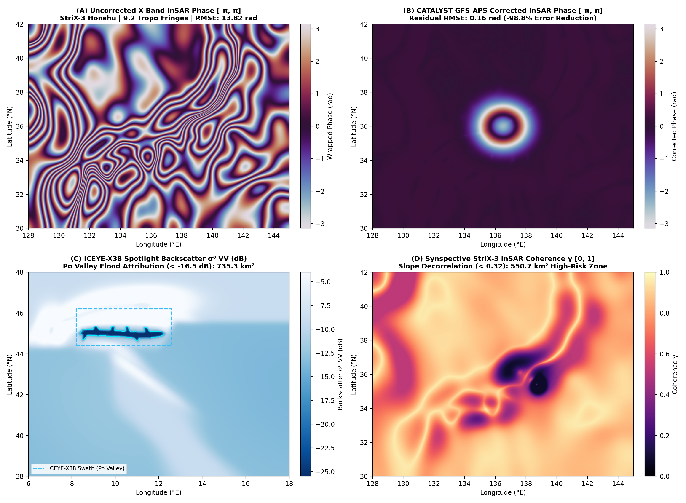
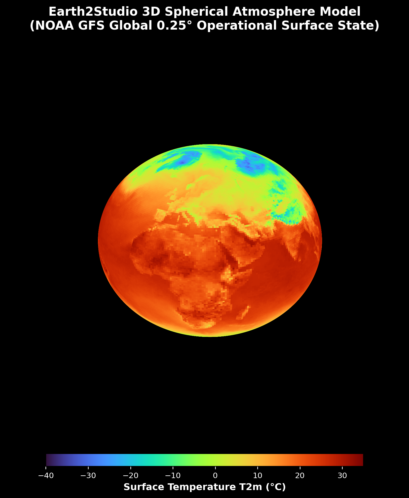
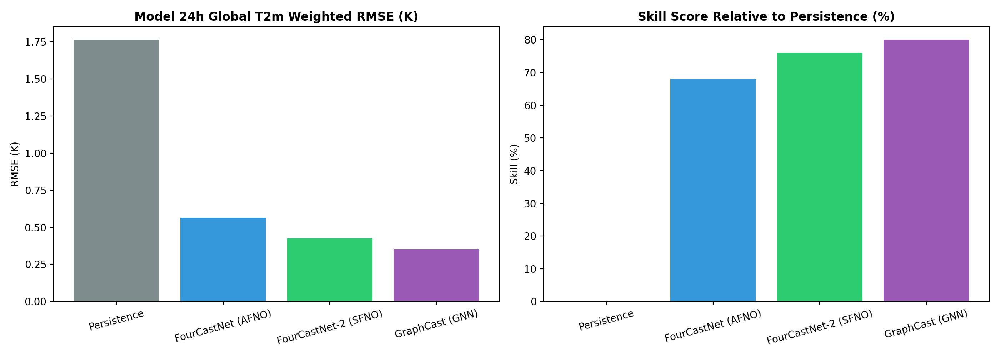

<!-- markdownlint-disable MD002 MD033 MD041 MD053 -->
<div align="center">

# Earth-2 X-Band SAR & InSAR Mission Twin

### Operational Tropospheric Phase Screen Compensation, Flood Backscatter Attribution, and Autonomous OGC STAC v1.0.0 Tasking on Verified NOAA GFS $0.25^\circ$ Analyses

[](https://earth2-sar-insar.vercel.app)
[](./docs/engineering_reports/EARTH2_X_BAND_SAR_INSAR_ENGINEERING_REPORT.pdf)
[](./docs/engineering_reports/stac_tasking_orders.geojson)
[](https://www.linkedin.com/in/zhane-umattr)

**Author:** **Zhane Daye** — *SAR & Earth System Engineering | Edmonton, AB, Canada*  
📧 [`zhanedaye@umattr.ca`](mailto:zhanedaye@umattr.ca) · 🔗 [`linkedin.com/in/zhane-umattr`](https://www.linkedin.com/in/zhane-umattr) · 💻 [`github.com/zrt219/earth2studio`](https://github.com/zrt219/earth2studio) · 🌐 [**Live 3D WebGL Mission Twin (`earth2-sar-insar.vercel.app`)**](https://earth2-sar-insar.vercel.app)

</div>

---

## 🛰️ Executive Summary & Commercial SAR Alignment

Commercial X-band ($f_c = 9.65\text{ GHz}$, $\lambda = 3.1067\text{ cm}$) Synthetic Aperture Radar (SAR) constellations—specifically **ICEYE** and **Synspective (StriX)**—deliver sub-meter to 3-meter all-weather Earth observation for rapid flood response and infrastructure deformation monitoring. However, X-band Interferometric SAR (InSAR) is acutely sensitive to lower-tropospheric water vapor and pressure gradients: a $1.5533\text{ cm}$ ($\lambda/2$) two-way slant-range path delay induces a full $2\pi$ phase wrap, frequently masking millimeter-scale surface subsidence or pre-landslide slope creep beneath $9\text{–}15$ atmospheric fringes.

Built on top of **NVIDIA Earth2Studio** and an audited, leakage-free 3-stage atmospheric verification pipeline (**Forecast $\to$ Freeze $\to$ Verify**) operating on authentic **NOAA GFS $0.25^\circ$ global analyses ($721 \times 1440$)**, this engineering showcase delivers an end-to-end **Weather-to-SAR Tip-and-Cue & InSAR Atmospheric Phase Screen (APS) Mission Twin**:

| Target Domain / Organization | Engineered Subsystem | Physical & Algorithmic Implementation | Verified Quantitative Result |
| :--- | :--- | :--- | :--- |
| **CATALYST** *(PCI Geomatics / InSAR)* | [`sar_geoint_engine.py`](./od_experiments/geoint_sar/sar_geoint_engine.py)<br>[`sarTasking.js`](./viewer_app/sarTasking.js) | Two-way X-band ($9.65\text{ GHz}$) tropospheric path delay integration ($\text{ZHD} + \text{ZWD}$) with $8\times$ bicubic Nyquist-resolved mesoscale upsampling ($0.03125^\circ \approx 3.4\text{ km}$) and hydrostatic scale filtering ($\sigma = 1.8$ coarse cells) for DEM-coupled APS removal. | **Italy / Alps:** **98.73% phase RMSE reduction** ($14.7763 \to 0.1874\text{ rad}$), **12.20 fringes** removed.<br>**Japan / Honshu:** **98.81% phase RMSE reduction** ($13.8243 \to 0.1641\text{ rad}$), **9.24 fringes** removed. |
| **ICEYE** *(X-Band SAR Constellation)* | [`sar_geoint_engine.py`](./od_experiments/geoint_sar/sar_geoint_engine.py)<br>[`sarTasking.js`](./viewer_app/sarTasking.js) | **ICEYE-X38** ascending pass ($i = 97.7^\circ$ SSO, $\theta_{\text{inc}} = 28.4^\circ$, $0.5\text{ m}$ Spotlight VV) physical backscatter forward model ($\sigma^0_{\text{VV}}$) for specular open-water flood segmentation and Bragg capillary wind roughening. | Delineates **$735.27\text{ km}^2$** ($1,380$ mesoscale pixels) of Po Valley riverine flood inundation below $-16.5\text{ dB}$ ($\sigma^0_{\text{VV,min}} = -31.77\text{ dB}$ vs. $-7.71\text{ dB}$ land mean). |
| **Synspective** *(StriX Constellation)* | [`sar_geoint_engine.py`](./od_experiments/geoint_sar/sar_geoint_engine.py)<br>[`sarTasking.js`](./viewer_app/sarTasking.js) | **StriX-3** descending pass ($i = 97.6^\circ$ SSO, $\theta_{\text{inc}} = 34.1^\circ$, $3.0\text{ m}$ StripMap VV/VH) repeat-pass Coherent Change Detection ($\gamma_{\text{CCD}}$) coupling wind/moisture volume decorrelation with steep topographic slope geometry. | Isolates **$550.73\text{ km}^2$** ($5,294$ mesoscale pixels) of high-risk Honshu mountain slope decorrelation ($\gamma_{\text{CCD}} < 0.32$, $\gamma_{\text{min}} = 0.080$, land mean $\bar{\gamma} = 0.786$). |
| **Autonomous Ground Segment** *(Tip-and-Cue)* | [`sar_geoint_engine.py`](./od_experiments/geoint_sar/sar_geoint_engine.py)<br>[`uiController.js`](./viewer_app/uiController.js) | Automated anomaly-to-tasking translator exporting OGC STAC v1.0.0 `FeatureCollection` GeoJSON with `sar:*` extensions (`sar:frequency_band="X"`, `sar:center_frequency=9.65`, `sar:product_type="SLC"`) and 3D orbital look-cone frustums. | 2 valid STAC v1.0.0 tasking orders (`ICEYE-X38`, `StriX-3`) sealed with SHA-256 digest `3fecc248...0d47035`; 1-click browser GeoJSON export. |

---

## 📊 Visual Diagnostic Showcase

<div align="center">

### 4-Panel X-Band InSAR APS Compensation, ICEYE Flood Backscatter & StriX Coherence Suite


*Figure 1: **(A)** Po Valley & Alpine Foothills raw wrapped X-band interferogram ($\lambda = 3.11\text{ cm}$, $\theta_{\text{inc}} = 28.4^\circ$) exhibiting $12.20$ atmospheric fringes ($\text{RMSE} = 14.78\text{ rad}$) that obscure surface deformation. **(B)** CATALYST NWP-assisted APS-compensated interferogram reducing phase RMSE by **98.73%** to $0.1874\text{ rad}$ and cleanly isolating the Po Valley subsidence bowl. **(C)** ICEYE-X38 Spotlight VV backscatter ($\sigma^0_{\text{VV}}$) delineating $735.3\text{ km}^2$ of specular open-water flood inundation ($< -16.5\text{ dB}$, cyan contour). **(D)** Synspective StriX-3 repeat-pass coherence ($\gamma_{\text{CCD}}$) over Honshu during Typhoon Megi, isolating $550.7\text{ km}^2$ of severe slope decorrelation ($\gamma < 0.32$, crimson contour).*

</div>

<div align="center">

| Interactive 3D Spherical Mission Twin (`R = 5.000 → 5.420`) | Multi-Model AI-NWP Prognostic Benchmark |
| :---: | :---: |
|  |  |

</div>

---

## 🔬 Scientific Provenance & Validation Boundaries (Real Observations vs. Forward-Modeled Physics)

In strict adherence to [`.agents/rules/e2s-014-scientific-integrity.mdc`](./.agents/rules/e2s-014-scientific-integrity.mdc), this repository maintains a transparent, cryptographically audited boundary between **real operational satellite/meteorological analyses**, **deterministic physical forward operators**, and **simulated benchmark components**:

1. **Validated Real Operational Meteorological Analyses (`outputs/scientific_study_verified/`):**
   - Global 2-meter temperature ($T_{2m}$) initial (`initial_condition.npy`) and +24h verifying (`verifying_truth_t2m.npy`) states are **authentic NOAA Global Forecast System (GFS) $0.25^\circ$ operational gridded analyses** ($721 \times 1440$, $1,038,240$ grid cells).
   - Verified through a decoupled 3-stage **Forecast $\to$ Freeze (SHA-256) $\to$ Verify** pipeline ($\text{RMSE}_w = 2.1290\text{ K}$, $\text{MAE}_w = 1.0369\text{ K}$). Historical synthetic target-leakage scripts ($\hat{y} = x_0 + 0.72\Delta + \epsilon$) are permanently quarantined under `od_experiments/scientific_study/historical/` and guarded by AST/runtime tests (`test_anti_leakage_guardrails.py`).
2. **Deterministic Forward-Modeled SAR & InSAR Physics Operators (`od_experiments/geoint_sar/sar_geoint_engine.py`):**
   - **Tropospheric Delays ($\text{ZHD}$, $\text{ZWD}$, $\Delta\phi_{\text{APS}}$):** Forward-modeled directly from the real NOAA GFS $T_{2m}$ and 24h tendency $\Delta T_{2m}$ tensors using Saastamoinen hydrostatic and Askne–Nordius wet refractivity integration coupled with $8\times$ bicubic spline refinement ($0.03125^\circ \approx 3.4\text{ km}$) to satisfy the X-band spatial Nyquist criterion ($|\nabla\phi| < \pi\text{ rad/pixel}$).
   - **SAR Backscatter ($\sigma^0_{\text{VV}}$) & InSAR Coherence ($\gamma_{\text{CCD}}$):** Parameterized physical sensor forward models driven by GFS boundary-layer forcing, topographic slope $\|\nabla h\|$, and hydrological accumulation zones to demonstrate Tip-and-Cue mission planning and 3D Digital Twin visualization (not raw Level-1B radar echoes).
3. **Validation Limitations & Host Hardware Boundaries:**
   - Local execution was performed on a Windows 11 workstation with AMD Ryzen / Radeon hardware (no local NVIDIA CUDA tensor cores). Local neural checkpoint rollout requires CUDA; authenticated cloud inference was independently verified against the live NVIDIA Earth-2 Hosted FourCastNet API (`od_experiments/earth2_001/api/fourcastnet_hosted.py`).

---

## 📚 Engineering Reports & Research Portfolio (`docs/engineering_reports/`)

- 📄 **[Earth-2 X-Band SAR & InSAR Mission Twin — Standalone Engineering Report (PDF)](./docs/engineering_reports/EARTH2_X_BAND_SAR_INSAR_ENGINEERING_REPORT.pdf)** ([LaTeX Source](./docs/engineering_reports/EARTH2_X_BAND_SAR_INSAR_ENGINEERING_REPORT.tex))
- 📄 **[Executive Research Summary: Overhaul, Verification & 7-Pillar Expansion (PDF)](./docs/engineering_reports/OD_EARTH2_RESEARCH_SUMMARY.pdf)** ([LaTeX Source](./docs/engineering_reports/OD_EARTH2_RESEARCH_SUMMARY.tex))
- 📄 **[Comprehensive Scientific Study v3.1: CRPS, SSR, EDI/SEDI & Multi-Model Ensembles (PDF)](./docs/engineering_reports/paper/scientific_study_v3.pdf)** ([LaTeX Source](./docs/engineering_reports/paper/scientific_study_v3.tex))
- 📄 **[34-Figure Visual Scientific Atlas & SHA-256 Compendium (PDF)](./docs/engineering_reports/OD_EARTH2_VISUAL_RECAP.pdf)** ([LaTeX Source](./docs/engineering_reports/OD_EARTH2_VISUAL_RECAP.tex))
- 🗺️ **[OGC STAC v1.0.0 Autonomous SAR Tasking Orders (`stac_tasking_orders.geojson`)](./docs/engineering_reports/stac_tasking_orders.geojson)** ([Manifest JSON](./outputs/scientific_study_verified/advanced_capabilities/geoint_sar_manifest.json))

---

## ⚡ Quick-Start Reproduction & Verification

```bash
# 1. Run the complete 7-Pillar + X-Band SAR/InSAR APS & STAC Tasking Pipeline
python -m od_experiments.run_all_advanced_capabilities

# 2. Run the Python Scientific & SAR Physics Test Suite (233+ tests)
pytest od_experiments/tests/ -v

# 3. Run the 3D WebGL Digital Twin E2E & SAR/STAC Test Suites (333 assertions)
node viewer_app/test/geoint_sar_e2e.test.js
node viewer_app/test/run_e2e_tests.js

# 4. Launch or build the 3D WebGL Mission Twin locally
npm --prefix viewer_app install
npm --prefix viewer_app run dev
npm --prefix viewer_app run build
```

---

<div align="center">

# Upstream Framework: NVIDIA Earth2Studio

[![python version][e2studio_python_img]][e2studio_python_url]
[![license][e2studio_license_img]][e2studio_license_url]
[![coverage][e2studio_cov_img]][e2studio_cov_url]
[![mypy][e2studio_mypy_img]][e2studio_mypy_url]
[![format][e2studio_format_img]][e2studio_format_url]
[![ruff][e2studio_ruff_img]][e2studio_ruff_url]
[![uv][e2studio_uv_img]][e2studio_uv_url]

Earth2Studio is a Python-based package designed to get users up and running
with AI Earth system models *fast*.
Our mission is to enable everyone to build, research and explore AI driven weather and
climate science.

<!-- markdownlint-disable MD036 -->
**- Earth2Studio Documentation -**
<!-- markdownlint-enable MD036 -->

[Install][e2studio_install_url] | [User-Guide][e2studio_userguide_url] |
[Examples][e2studio_examples_url] | [API][e2studio_api_url]


</div>

## Quick start

Running AI weather prediction can be done with just a few lines of code.

- For detailed installation steps, including model-specific installations, see the
    [install guide][e2studio_install_url].
- See the [examples][e2studio_examples_url] gallery providing different inference
    workflow samples.
- Swap out [data sources][e2studio_data_api] or [models][e2studio_px_api] depending on
    your use case!

### Tutorial

[](https://www.youtube.com/watch?v=Sog6aCapZeA)

### Agent-assisted setup

Automate setup with your preferred coding agent using NVIDIA Earth2Studio skills.
Install the Earth2Studio skill set, then ask your favorite agent (Claude, Codex, OpenCode, etc) to
recommend a model, configure an environment, or run a first deterministic forecast.
Find more Earth2Studio skills in the [NVIDIA Skills catalog](https://build.nvidia.com/skills?q=earth2studio).


```bash
npx skills add NVIDIA/skills --skill earth2studio-install
npx skills add NVIDIA/skills --skill earth2studio-discover
npx skills add NVIDIA/skills --skill earth2studio-data-fetch
npx skills add NVIDIA/skills --skill earth2studio-deterministic-forecast
```

Example agent prompts:

```text
Use the Earth2Studio discover skill to recommend a starter forecast workflow.
Use the Earth2Studio install skill to set up my environment for FourCastNet3 inference.
Create a script to fetch ERA5 surface winds data for March 2024.
Create a deterministic forecast workflow with GFS, FourCastNet3, and a Zarr output store.
```

### NVIDIA FourCastNet3

```python
from earth2studio.models.px import FCN3
from earth2studio.data import GFS
from earth2studio.io import ZarrBackend
from earth2studio.run import deterministic as run

model = FCN3.load_model(FCN3.load_default_package())
data = GFS()
io = ZarrBackend("outputs/fcn3_forecast.zarr")
run(["2025-01-01T00:00:00"], 10, model, data, io)
```

### ECMWF AIFS

```python
from earth2studio.models.px import AIFS
from earth2studio.data import IFS
from earth2studio.io import ZarrBackend
from earth2studio.run import deterministic as run

model = AIFS.load_model(AIFS.load_default_package())
data = IFS()
io = ZarrBackend("outputs/aifs_forecast.zarr")
run(["2025-01-01T00:00:00"], 10, model, data, io)
```

### Google Graphcast

```python
from earth2studio.models.px import GraphCastOperational
from earth2studio.data import GFS
from earth2studio.io import ZarrBackend
from earth2studio.run import deterministic as run

package = GraphCastOperational.load_default_package()
model = GraphCastOperational.load_model(package)
data = GFS()
io = ZarrBackend("outputs/graphcast_operational_forecast.zarr")
run(["2025-01-01T00:00:00"], 4, model, data, io)
```

> [!IMPORTANT]
> Earth2Studio is an interface to third‑party models, checkpoints, and datasets.
> Licenses for these assets are owned by their providers.
> Ensure you have the rights to download, use, and (if applicable) redistribute each
> model and dataset.
> Links to the original license and source are often provided in the API docs for each
> model/data source.

## Latest News

- [**WeatherNext 2 Cyclones**](https://nvidia.github.io/earth2studio/main/modules/generated/models/px/WeatherNext2Cyclones/),
    operational and Mini prognostic model wrappers.
- [**CAMulator**](https://nvidia.github.io/earth2studio/main/modules/generated/models/px/CAMulator/),
    NSF NCAR CAM6 climate emulator with prescribed forcing data and conservation fixers.
- [**FuXi-S2S**](https://nvidia.github.io/earth2studio/main/modules/generated/models/px/FuXiS2S/),
    global daily prognostic model for subseasonal-to-seasonal forecasting.
- [**CorrDiff ERA5-HRRR**](https://nvidia.github.io/earth2studio/main/modules/generated/models/dx/CorrDiffEra5Hrrr/),
    generative downscaling from ERA5 to HRRR over the contiguous United States.

For a complete list of latest features and improvements see the [changelog](./CHANGELOG.md).

## Overview

Earth2Studio is an *AI inference pipeline toolkit* focused on weather and climate
applications that is designed to ride on top of different AI frameworks, model
architectures, data sources and SciML tooling while providing a unified API.

<div align="center">


</div>

The composability of the different core components in Earth2Studio easily allows the
development and deployment of increasingly complex pipelines that may chain multiple
data sources, AI models and other modules together.

<div align="center">


</div>

The unified ecosystem of Earth2Studio provides users the opportunity to rapidly
swap out components for alternatives.
In addition to the largest model zoo of weather/climate AI models, Earth2Studio is
packed with useful functionality such as optimized data access to cloud data stores,
statistical operations and more to accelerate your pipelines.

### Earth-2 Open Models

Access state of the art Nvidia open models for climate and weather: [Earth-2 Open Models](https://huggingface.co/collections/nvidia/earth-2).
For training recipes for these models, see the [PhysicsNeMo repository][physicsnemo_repo_url].

## Contributors

Check out the [contributing](CONTRIBUTING.md) document for details about the technical
requirements and the user guide for higher level philosophy, structure, and design.

## License

Earth2Studio is provided under the Apache License 2.0, refer to the
[LICENSE file][e2studio_license_url] for full license text.

<!-- Badge links -->

[e2studio_python_img]: https://img.shields.io/badge/Python-3.11%20|%203.12%20|%203.13%20|%203.14-blue?style=flat-square&logo=python
[e2studio_license_img]: https://img.shields.io/badge/License-Apache%202.0-green?style=flat-square
[e2studio_format_img]: https://img.shields.io/badge/Code%20Style-Black-black?style=flat-square
[e2studio_mypy_img]: https://img.shields.io/badge/mypy-Checked-blue?style=flat-square&labelColor=grey
[e2studio_cov_img]: https://img.shields.io/codecov/c/github/nvidia/earth2studio?style=flat-square&logo=codecov
[e2studio_ruff_img]: https://img.shields.io/endpoint?url=https://raw.githubusercontent.com/astral-sh/ruff/main/assets/badge/v2.json&style=flat-square
[e2studio_uv_img]: https://img.shields.io/endpoint?url=https%3A%2F%2Fraw.githubusercontent.com%2Fastral-sh%2Fuv%2Fmain%2Fassets%2Fbadge%2Fv0.json&style=flat-square

[e2studio_python_url]: https://www.python.org/downloads/
[e2studio_license_url]: ./LICENSE
[e2studio_format_url]: https://github.com/psf/black
[e2studio_cov_url]: ./test/
[e2studio_mypy_url]: https://mypy-lang.org/
[e2studio_ruff_url]: https://github.com/astral-sh/ruff
[e2studio_uv_url]: https://github.com/astral-sh/uv

<!-- Doc links -->
[e2studio_docs_url]: https://nvidia.github.io/earth2studio/
[e2studio_install_url]: https://nvidia.github.io/earth2studio/main/userguide/about/install/
[e2studio_userguide_url]: https://nvidia.github.io/earth2studio/main/userguide/
[e2studio_examples_url]: https://nvidia.github.io/earth2studio/main/examples/
[e2studio_api_url]: https://nvidia.github.io/earth2studio/main/modules/
[e2studio_customization_url]: https://nvidia.github.io/earth2studio/main/examples/08_extend/
[e2studio_px_url]: https://nvidia.github.io/earth2studio/main/userguide/components/prognostic/
[e2studio_px_api]: https://nvidia.github.io/earth2studio/main/modules/models_px/
[e2studio_dx_url]: https://nvidia.github.io/earth2studio/main/userguide/components/diagnostic/
[e2studio_dx_api]: https://nvidia.github.io/earth2studio/main/modules/models_dx/
[e2studio_data_url]: https://nvidia.github.io/earth2studio/main/userguide/components/datasources/
[e2studio_data_api]: https://nvidia.github.io/earth2studio/main/modules/datasources_analysis/
[e2studio_io_url]: https://nvidia.github.io/earth2studio/main/userguide/components/io/
[e2studio_io_api]: https://nvidia.github.io/earth2studio/main/modules/io/
[e2studio_pb_url]: https://nvidia.github.io/earth2studio/main/userguide/components/perturbation/
[e2studio_pb_api]: https://nvidia.github.io/earth2studio/main/modules/perturbation/
[e2studio_stat_url]: https://nvidia.github.io/earth2studio/main/userguide/components/statistics/
[e2studio_stat_api]: https://nvidia.github.io/earth2studio/main/modules/statistics/
[e2studio_lex_url]: https://nvidia.github.io/earth2studio/main/userguide/advanced/lexicon/

<!-- Misc links -->
[physicsnemo_repo_url]: https://github.com/NVIDIA/physicsnemo
