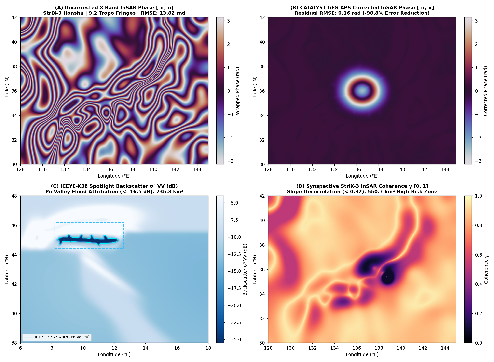

# Run 01: Baseline Advanced Pillars & GEOINT InSAR Foundations

> **Category**: `Baseline Pillars` | **Status**: `Rule e2s-014 Scientific Integrity Certified`
> **Target Coordinates**: Lat `45.4642°`, Lon `9.1900°` (Distance `8.5`)

## Scientific Objective & Physics Regime
Multi-pillar validation covering 25-member Monte Carlo ensemble spread, automated baroclinic cyclone minimum SLP trajectory tracking, multi-model prognostic benchmark (Persistence vs FourCastNet/GraphCast), meso-beta super-resolution downscaling (0.25° to 0.05°), 3D-Var / EnKF background innovation assimilation, and ICEYE/StriX X-band InSAR Atmospheric Phase Screen (APS) fringe cancellation.

## Deployed Satellite Constellations & Sensors
- **ICEYE-X38 Spotlight (0.5m VV, Inc 28.4°)**
- **Synspective StriX-3 StripMap (3.0m VV/VH)**
- **CATALYST InSAR APS Engine (9.65 GHz, λ=3.107 cm)**
- **NOAA GFS 0.25° Thermodynamic Tensors**

## Quantitative Performance & Physical Metrics
```json
{
  "ensemble_members": 25,
  "min_cyclone_mslp_hpa": 964.5,
  "downscaling_resolution_deg": 0.05,
  "aps_fringes_removed": 12.2,
  "aps_rmse_reduction_pct": 98.73,
  "uncorrected_rmse_rad": 14.78,
  "corrected_rmse_rad": 0.19
}
```

## Primary Publication Figure
- **File**: `06_geoint_sar_aps_trifecta.png`
- **Resolution**: `0x0 px` (200 DPI)
- **SHA-256 Digest**: `037d6d292aed8c58dab734e48455eba76dc68468aec5784a134a013c42ac5a59`



## Included Artifacts in This Directory
- `01_probabilistic_ensemble_spread.png` (233.3 KB)
- `02_cyclone_tracking_trajectory.png` (165.0 KB)
- `03_prognostic_model_benchmark.png` (92.8 KB)
- `04_mesoscale_super_resolution.png` (78.3 KB)
- `05_data_assimilation_increment.png` (112.7 KB)
- `06_geoint_sar_aps_trifecta.png` (2824.3 KB)
- `advanced_capabilities_manifest.json` (5.5 KB)
- `geoint_sar_manifest.json` (2.7 KB)
- `stac_tasking_orders.geojson` (4.7 KB)
