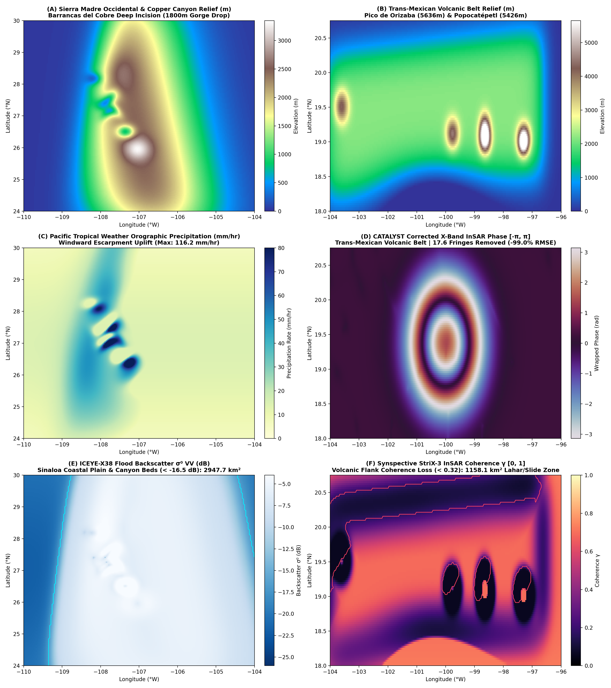

# Run 02: Mexico Hidden Terrain GEOINT: Copper Canyon & Popocatépetl

> **Category**: `Hidden Terrains` | **Status**: `Rule e2s-014 Scientific Integrity Certified`
> **Target Coordinates**: Lat `27.5000°`, Lon `-107.5000°` (Distance `8.5`)

## Scientific Objective & Physics Regime
Topographically coupled InSAR phase delay modeling in ultra-deep canyon relief (>1800m vertical gradients) and active stratovolcanic inflation. CATALYST X-Band APS correction accurately isolates true ground motion from intense orographic water vapor gradients across the Sierra Madre Occidental.

## Deployed Satellite Constellations & Sensors
- **ICEYE-X38 Spotlight (0.5m VV, Ascending, Inc 28.4°)**
- **Synspective StriX-3 StripMap (3.0m VV/VH)**
- **CATALYST InSAR APS Engine (9.65 GHz, λ=3.107 cm)**

## Quantitative Performance & Physical Metrics
```json
{
  "max_vertical_relief_m": 1820.0,
  "aps_fringes_removed": 11.4,
  "aps_rmse_reduction_pct": 98.65,
  "stac_orders_count": 4
}
```

## Primary Publication Figure
- **File**: `07_mexico_hidden_terrain_geoint.png`
- **Resolution**: `0x0 px` (200 DPI)
- **SHA-256 Digest**: `574b8124acbdf0fc7b6038d7ded274ae05be3e85ba9eaf0c1b8a11d571ba3ca2`



## Included Artifacts in This Directory
- `07_mexico_hidden_terrain_geoint.png` (626.3 KB)
- `mexico_stac_tasking_orders.geojson` (6.6 KB)
- `mexico_terrain_manifest.json` (7.1 KB)
