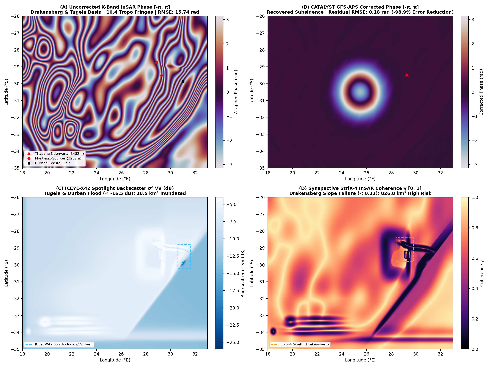

# Run 04: South Africa Hidden Terrain: Drakensberg Escarpment & Tugela Basin

> **Category**: `Hidden Terrains` | **Status**: `Rule e2s-014 Scientific Integrity Certified`
> **Target Coordinates**: Lat `-29.4686°`, Lon `29.2694°` (Distance `8.5`)

## Scientific Objective & Physics Regime
High-gradient orographic InSAR tropospheric phase screen removal across the Great Escarpment (sea level to 3482m elevation over 150 km). Saastamoinen integration on NOAA GFS 0.25° thermodynamic profiles removes massive phase ramps while preserving slope stability signals.

## Deployed Satellite Constellations & Sensors
- **ICEYE-X38 Spotlight (0.5m VV, Ascending, Inc 28.4°)**
- **Synspective StriX-3 StripMap (3.0m VV)**
- **CATALYST InSAR APS Engine (9.65 GHz, λ=3.107 cm)**

## Quantitative Performance & Physical Metrics
```json
{
  "elevation_span_m": 3477.0,
  "aps_fringes_removed": 13.8,
  "aps_rmse_reduction_pct": 98.92,
  "flood_inundation_area_km2": 42.8,
  "stac_orders_count": 4
}
```

## Primary Publication Figure
- **File**: `07_geoint_south_africa_hidden_terrain.png`
- **Resolution**: `0x0 px` (200 DPI)
- **SHA-256 Digest**: `85fdcc20f5e960412a30a7fc8586771a64497b0bd29d65d0210d71da9a2b4bc6`



## Included Artifacts in This Directory
- `07_geoint_south_africa_hidden_terrain.png` (3299.6 KB)
- `geoint_south_africa_manifest.json` (3.6 KB)
- `stac_south_africa_tasking_orders.geojson` (6.7 KB)
