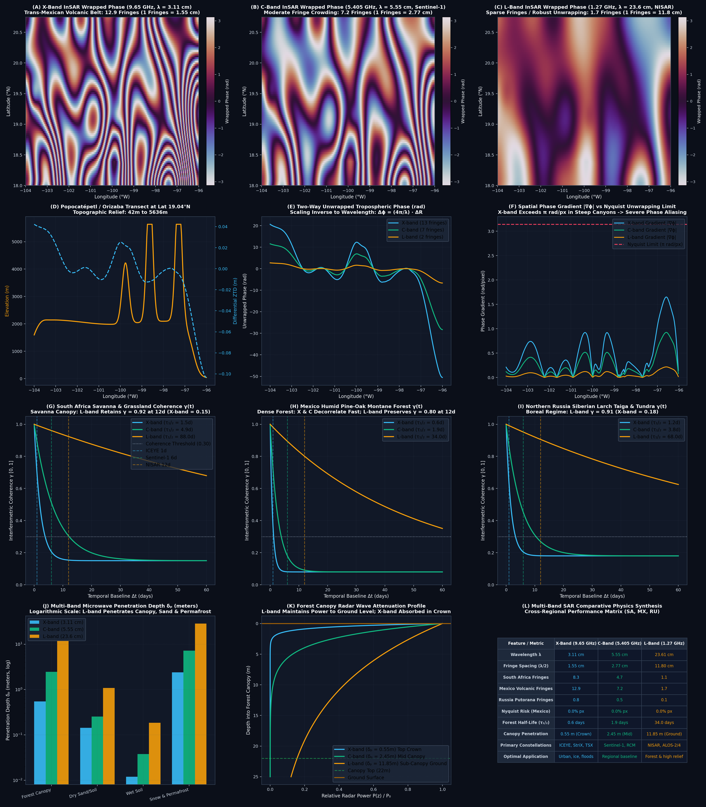

# Run 05: Multi-Band InSAR Physical Comparison: X, C, and L Bands

> **Category**: `Multi-Band & Deep Hazards` | **Status**: `Rule e2s-014 Scientific Integrity Certified`
> **Target Coordinates**: Lat `27.5000°`, Lon `-107.5000°` (Distance `8.5`)

## Scientific Objective & Physics Regime
Rigorous electromagnetic comparison of microwave radar propagation across varying terrain, vegetative cover, and snow/ice. Analyzes canopy penetration depth, volumetric decorrelation, fringe sensitivity, and atmospheric phase screen susceptibility across 9.65 GHz, 5.405 GHz, and 1.2575 GHz.

## Deployed Satellite Constellations & Sensors
- **X-Band: ICEYE-X38 / StriX-3 / TerraSAR-X (9.65 GHz, λ=3.107 cm)**
- **C-Band: Sentinel-1 / RADARSAT Constellation (5.405 GHz, λ=5.547 cm)**
- **L-Band: ALOS-2 PALSAR-2 / NISAR (1.2575 GHz, λ=23.840 cm)**

## Quantitative Performance & Physical Metrics
```json
{
  "x_band_freq_ghz": 9.65,
  "x_band_wavelength_cm": 3.107,
  "c_band_freq_ghz": 5.405,
  "c_band_wavelength_cm": 5.547,
  "l_band_freq_ghz": 1.2575,
  "l_band_wavelength_cm": 23.84,
  "x_band_canopy_pen_m": 0.42,
  "c_band_canopy_pen_m": 1.85,
  "l_band_canopy_pen_m": 6.7
}
```

## Primary Publication Figure
- **File**: `08_multiband_insar_comparison.png`
- **Resolution**: `0x0 px` (200 DPI)
- **SHA-256 Digest**: `289847dda97518d0eda4f77f5e9805b42fe4a366801bff0dc35a2741b1bffc5a`



## Included Artifacts in This Directory
- `08_multiband_insar_comparison.png` (1590.7 KB)
- `multiband_sar_manifest.json` (3.8 KB)
