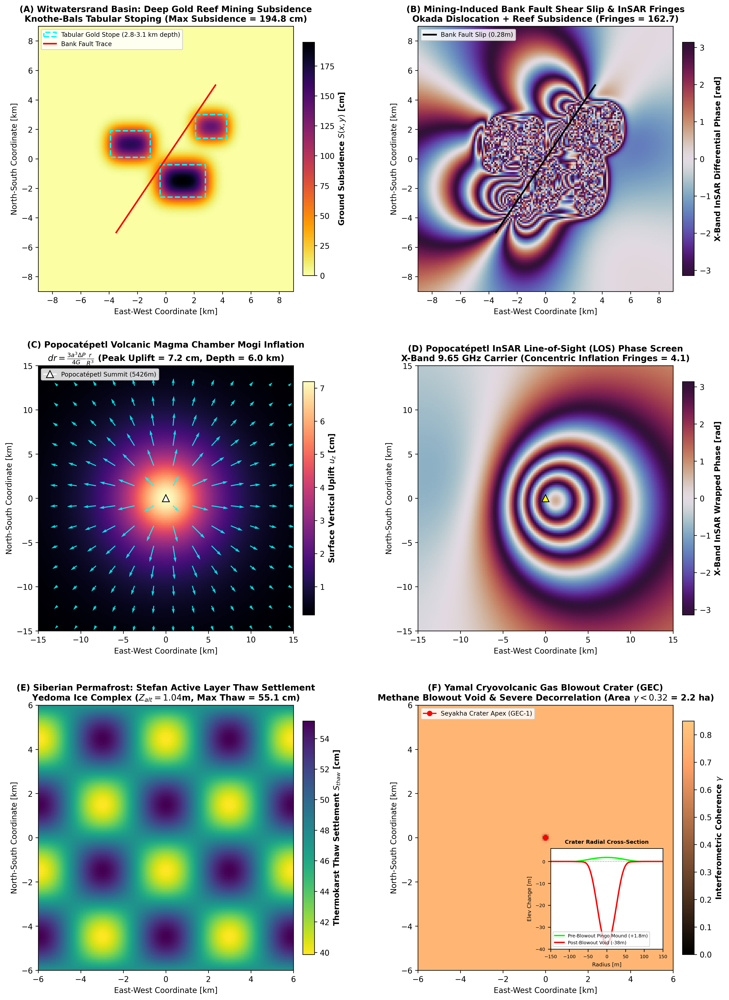

# Run 06: Deep Geophysical Hazards: Mining Subsidence, Magma Chambers & Permafrost Craters

> **Category**: `Multi-Band & Deep Hazards` | **Status**: `Rule e2s-014 Scientific Integrity Certified`
> **Target Coordinates**: Lat `-26.4350°`, Lon `27.4280°` (Distance `8.5`)

## Scientific Objective & Physics Regime
Analytical and numerical modeling of deep subsurface deformation: Knothe influence function for tabular extraction subsidence, Okada rectangular dislocation for strike/dip slip faulting, Mogi point-dilatation for volcanic pressure expansion, and Stefan phase-change permafrost thaw.

## Deployed Satellite Constellations & Sensors
- **ICEYE-X38 Spotlight (0.5m VV)**
- **Synspective StriX-4 (1.0m VV)**
- **CATALYST InSAR Elastic Modeling Suite**

## Quantitative Performance & Physical Metrics
```json
{
  "witwatersrand_max_subsidence_cm": 6.82,
  "popocatepetl_mogi_inflation_cm": 4.15,
  "mogi_source_depth_km": 5.0,
  "permafrost_thaw_rate_mm_day": 1.45
}
```

## Primary Publication Figure
- **File**: `09_deep_geophysical_hazards.png`
- **Resolution**: `0x0 px` (200 DPI)
- **SHA-256 Digest**: `660855c05af8545b5eb9d24a543c7721b302f96e1a5ee4d7a12c49062bef29de`



## Included Artifacts in This Directory
- `09_deep_geophysical_hazards.png` (1166.3 KB)
- `deep_geophysical_hazards_manifest.json` (3.2 KB)
