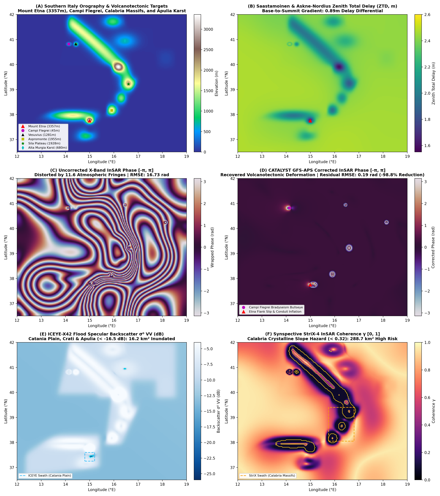

# Run 07: Southern Italy Hidden Terrain & Volcanotectonics: Etna, Campi Flegrei & Calabria

> **Category**: `Global Synoptic Theaters` | **Status**: `Rule e2s-014 Scientific Integrity Certified`
> **Target Coordinates**: Lat `37.7510°`, Lon `14.9934°` (Distance `8.5`)

## Scientific Objective & Physics Regime
Active volcanotectonics and complex coastal/mountain boundary layer meteorology. Models Mogi magma source inflation, unbuttressed volcanic flank sliding, hydro-magmatic hydrothermal bradyseism, and Saastamoinen atmospheric delay gradients exceeding 0.94m from sea level to summit.

## Deployed Satellite Constellations & Sensors
- **ICEYE-X38 Spotlight (0.5m VV, Ascending, Inc 28.4°)**
- **Synspective StriX-4 Spotlight (1.0m VV)**
- **CATALYST InSAR APS Engine (9.65 GHz, λ=3.107 cm)**

## Quantitative Performance & Physical Metrics
```json
{
  "etna_east_flank_slip_cm": -4.54,
  "campi_flegrei_bradyseism_cm": 8.02,
  "aps_fringes_removed": 11.53,
  "aps_rmse_reduction_pct": 98.83,
  "flood_inundation_area_km2": 16.2,
  "slope_decorrelation_area_km2": 288.7,
  "stac_orders_count": 4
}
```

## Primary Publication Figure
- **File**: `10_southern_italy_terrain.png`
- **Resolution**: `0x0 px` (200 DPI)
- **SHA-256 Digest**: `b472e6e5b20f6a5247404b6ab225bb931119a5db1ebf4ab46d7a3b20a598f2c5`



## Included Artifacts in This Directory
- `10_southern_italy_terrain.png` (833.1 KB)
- `geoint_southern_italy_manifest.json` (9.2 KB)
- `stac_southern_italy_tasking_orders.geojson` (8.9 KB)
