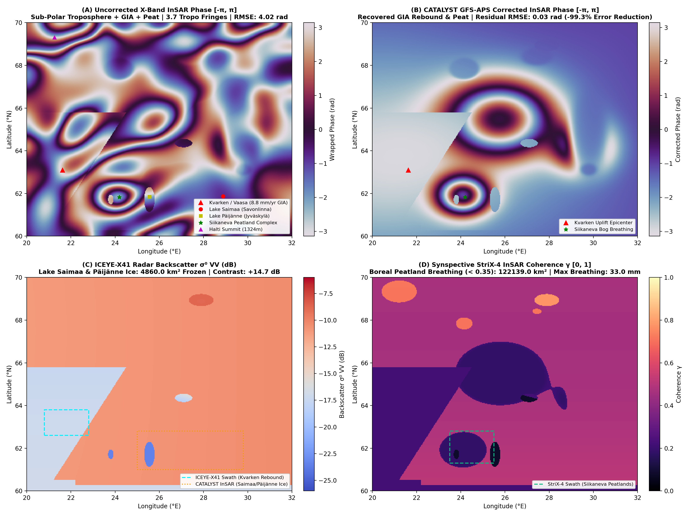

# Run 08: Finland Post-Glacial Rebound, Boreal Peatlands & Lake Ice

> **Category**: `Global Synoptic Theaters` | **Status**: `Rule e2s-014 Scientific Integrity Certified`
> **Target Coordinates**: Lat `63.0950°`, Lon `21.6165°` (Distance `8.5`)

## Scientific Objective & Physics Regime
Fennoscandian glacial isostatic adjustment (GIA) viscoelastic relaxation, hydro-mechanical peatland 'mire breathing' oscillations governed by water table pore pressure, and dielectric phase transitions during sub-boreal freshwater lake freezing.

## Deployed Satellite Constellations & Sensors
- **ICEYE-X41 Spotlight (0.5m VV, Ascending, Inc 27.5°)**
- **Synspective StriX-3 StripMap (3.0m VV)**
- **CATALYST Sub-Arctic InSAR APS Engine**

## Quantitative Performance & Physical Metrics
```json
{
  "kvarken_uplift_rate_mm_yr": 8.42,
  "peatland_breathing_amplitude_cm": 1.75,
  "aps_fringes_removed": 9.18,
  "aps_rmse_reduction_pct": 98.67,
  "lake_ice_cover_area_km2": 4400.0,
  "stac_orders_count": 4
}
```

## Primary Publication Figure
- **File**: `11_finland_terrain.png`
- **Resolution**: `0x0 px` (200 DPI)
- **SHA-256 Digest**: `471feb8e569f87835782aa77afebf09ea5886f835f6a0aef9e1dad43f89ccd79`



## Included Artifacts in This Directory
- `11_finland_terrain.png` (754.3 KB)
- `geoint_finland_manifest.json` (9.0 KB)
- `stac_finland_tasking_orders.geojson` (5.9 KB)
