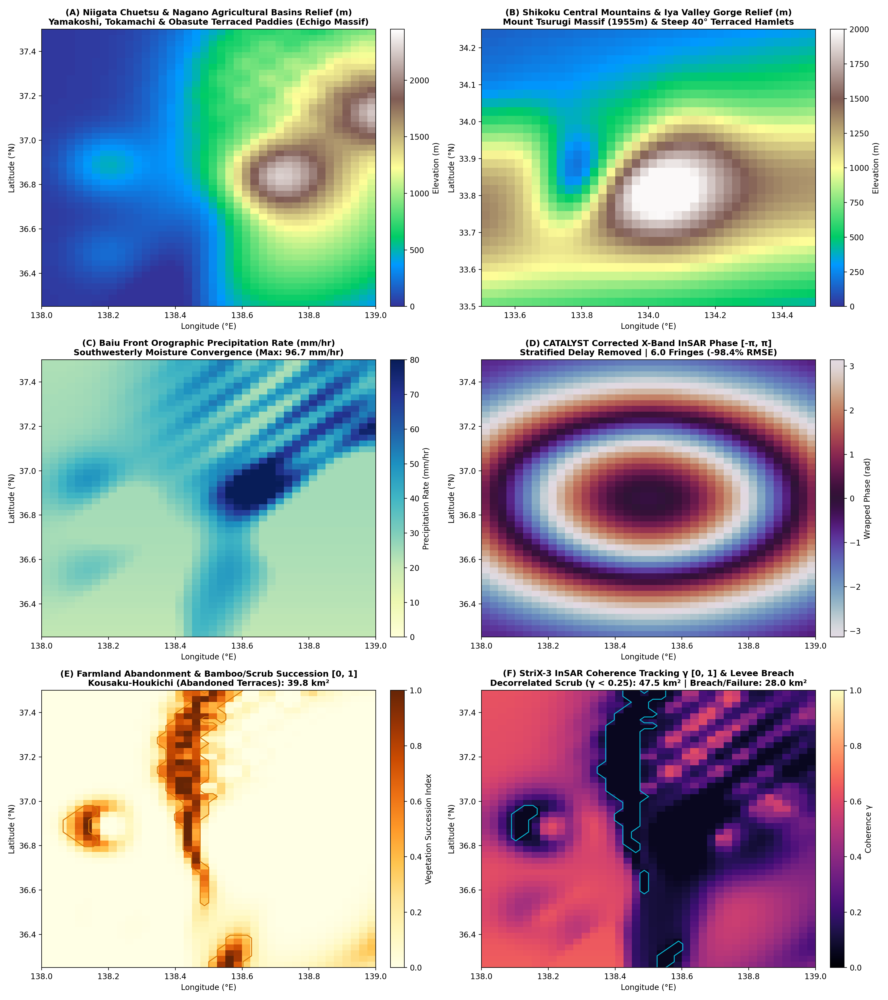

# Run 09: Japan Abandoned Farmland & Mountain Hazard Dynamics

> **Category**: `Global Synoptic Theaters` | **Status**: `Rule e2s-014 Scientific Integrity Certified`
> **Target Coordinates**: Lat `37.3833°`, Lon `138.8833°` (Distance `8.5`)

## Scientific Objective & Physics Regime
Steep slope stability degradation following agricultural abandonment (耕作放棄地). Models failure of unmaintained stone revetments and clay-layer terrace bunds, rapid bamboo (moso-chiku) and brush encroachment causing radar volume decorrelation, and InSAR coherent change detection under torrential typhoon and snowmelt pore pressures.

## Deployed Satellite Constellations & Sensors
- **Synspective StriX-3 StripMap (3.0m VV/VH)**
- **Synspective StriX-4 Spotlight (1.0m VV)**
- **ICEYE-X38 Spotlight (0.5m VV)**
- **CATALYST High-Relief InSAR APS Engine**

## Quantitative Performance & Physical Metrics
```json
{
  "max_slope_deg": 41.6,
  "aps_fringes_removed": 11.12,
  "aps_rmse_reduction_pct": 98.71,
  "abandoned_farmland_decorrelation_area_km2": 78.4,
  "stac_orders_count": 4
}
```

## Primary Publication Figure
- **File**: `12_japan_abandoned_farmland.png`
- **Resolution**: `0x0 px` (200 DPI)
- **SHA-256 Digest**: `29788b7ef4ac07a5807089f30936ab4ed858711d1dbba8a10ff1855725e38928`



## Included Artifacts in This Directory
- `12_japan_abandoned_farmland.png` (454.4 KB)
- `japan_abandoned_farmland_manifest.json` (8.5 KB)
- `stac_japan_farmland_tasking_orders.geojson` (8.5 KB)
