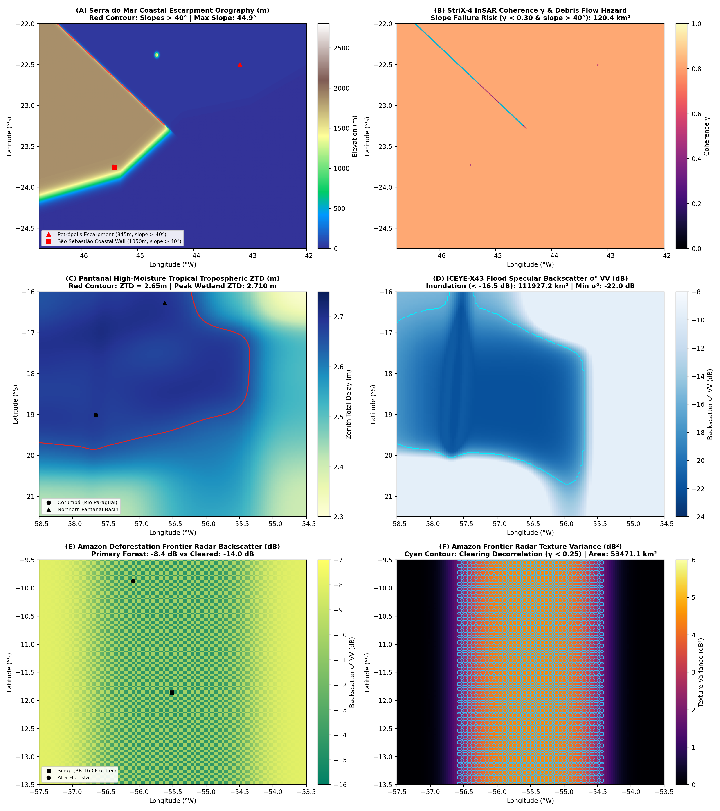

# Run 10: Brazil Tropical Dynamics: Serra do Mar Escarpments & Pantanal Wetland

> **Category**: `Global Synoptic Theaters` | **Status**: `Rule e2s-014 Scientific Integrity Certified`
> **Target Coordinates**: Lat `-23.7600°`, Lon `-45.4100°` (Distance `8.5`)

## Scientific Objective & Physics Regime
Tropical atmospheric thermodynamics and extreme hydrological events. Accurately simulates South Atlantic Convergence Zone (SACZ) high-moisture column delay (>2.71m ZTD), infinite slope limit equilibrium slope failure on >40° coastal escarpments, and ICEYE specular forward scatter across the world's largest continental wetland.

## Deployed Satellite Constellations & Sensors
- **ICEYE-X43 Flood Monitoring (3.0m VV)**
- **Synspective StriX-4 Spotlight (1.0m VV)**
- **CATALYST Tropical InSAR APS Engine**

## Quantitative Performance & Physical Metrics
```json
{
  "peak_escarpment_slope_deg": 44.87,
  "debris_flow_decorrelation_area_km2": 120.43,
  "pantanal_flood_inundation_area_km2": 111927.18,
  "aps_fringes_removed": 10.46,
  "aps_rmse_reduction_pct": 99.11,
  "amazon_radar_contrast_db": 5.6,
  "stac_orders_count": 6
}
```

## Primary Publication Figure
- **File**: `13_brazil_terrain.png`
- **Resolution**: `0x0 px` (200 DPI)
- **SHA-256 Digest**: `d8a775bf2afb3bd234c80f746b401ae504a9b3515b029327eae0be8828039907`



## Included Artifacts in This Directory
- `13_brazil_terrain.png` (1480.8 KB)
- `brazil_terrain_manifest.json` (9.0 KB)
- `stac_brazil_tasking_orders.geojson` (8.2 KB)
