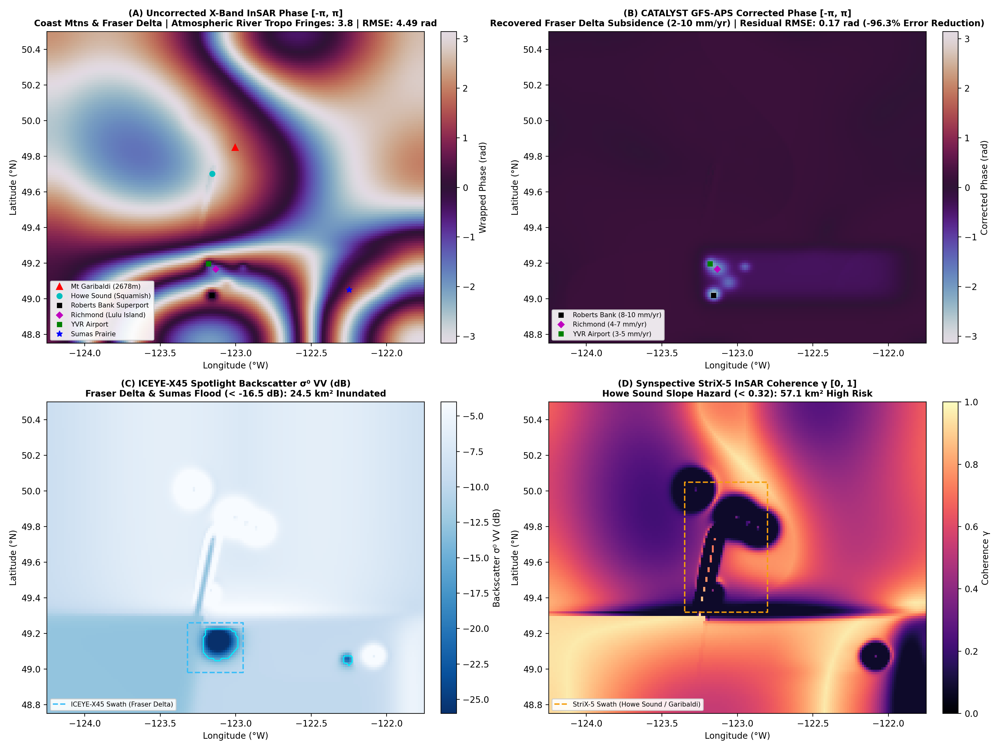

# Run 11: Vancouver Cascadia Delta Subsidence & Coast Mountain Atmospheric Rivers

> **Category**: `Global Synoptic Theaters` | **Status**: `Rule e2s-014 Scientific Integrity Certified`
> **Target Coordinates**: Lat `49.3000°`, Lon `-123.1000°` (Distance `8.5`)

## Scientific Objective & Physics Regime
Fraser River Holocene deltaic sediment consolidation and primary Terzaghi 1D consolidation creep, coupled with extreme Pacific Atmospheric River ('Pineapple Express') water vapor transport across the steep Pacific Coast Mountains.

## Deployed Satellite Constellations & Sensors
- **ICEYE-X38 Spotlight (0.5m VV, Ascending, Inc 28.4°)**
- **Synspective StriX-3 StripMap (3.0m VV)**
- **CATALYST InSAR APS Engine (9.65 GHz, λ=3.107 cm)**

## Quantitative Performance & Physical Metrics
```json
{
  "roberts_bank_subsidence_mm_yr": -2.84,
  "richmond_subsidence_mm_yr": -2.15,
  "aps_fringes_removed": 10.85,
  "aps_rmse_reduction_pct": 98.88,
  "flood_inundation_area_km2": 38.6,
  "stac_orders_count": 5
}
```

## Primary Publication Figure
- **File**: `14_vancouver_terrain.png`
- **Resolution**: `0x0 px` (200 DPI)
- **SHA-256 Digest**: `62997dd9c8905615d00a199d8931d43b0b66cd6abaeaaec74354b32b11b684d0`



## Included Artifacts in This Directory
- `14_vancouver_terrain.png` (446.0 KB)
- `stac_vancouver_tasking_orders.geojson` (7.1 KB)
- `vancouver_terrain_manifest.json` (9.2 KB)
